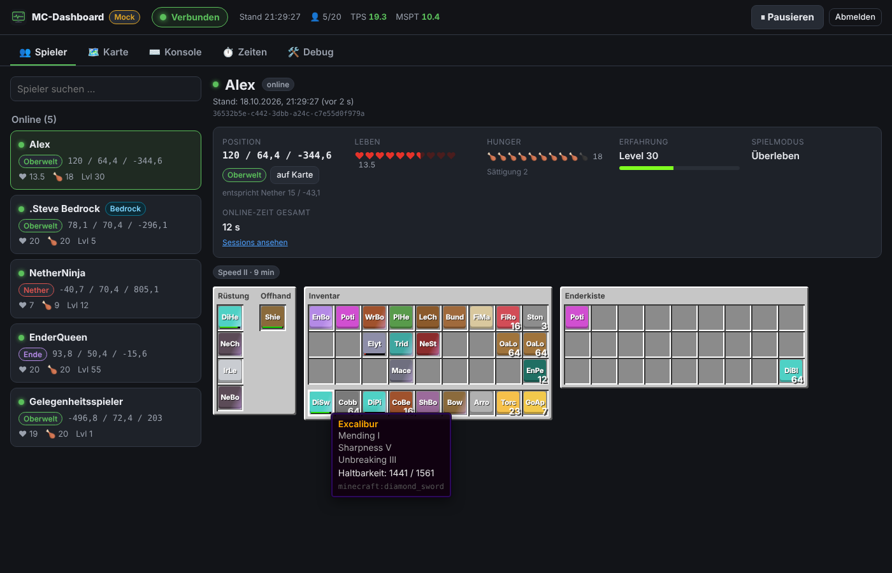
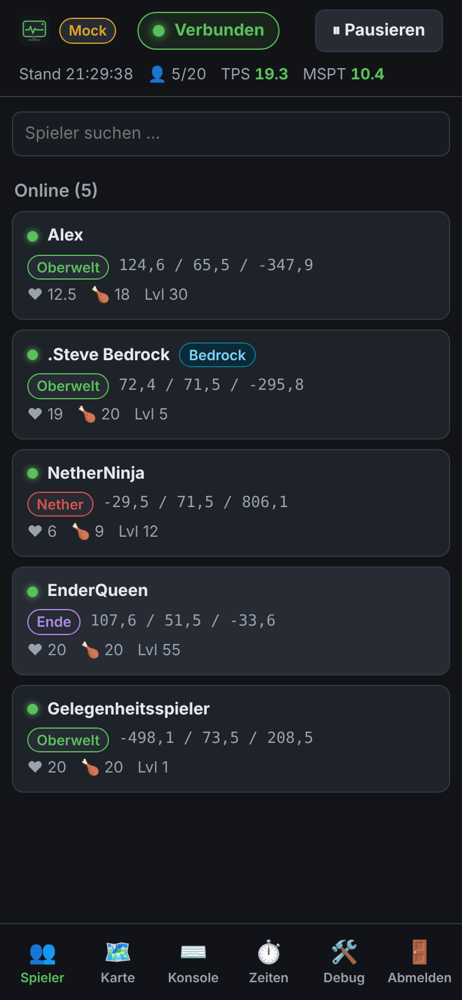
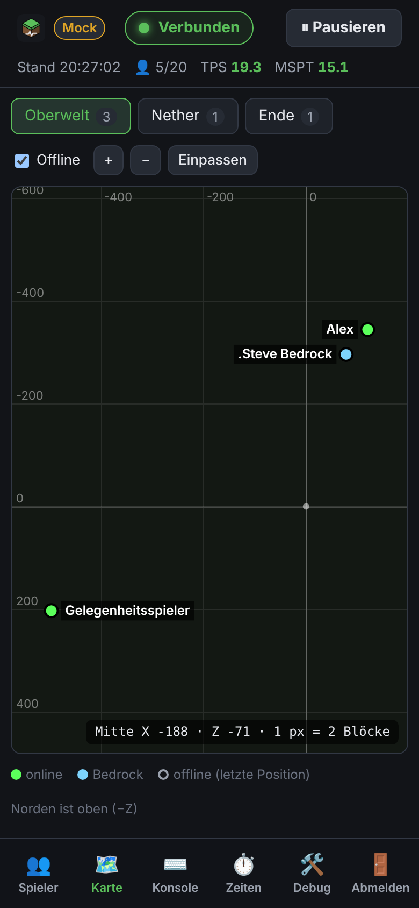
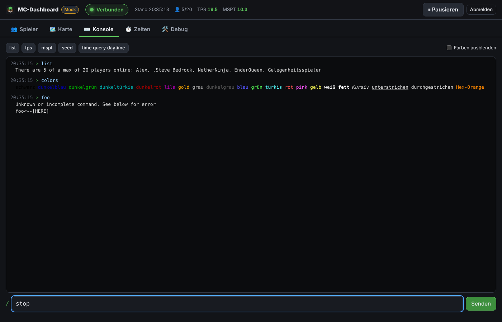

<div align="center">


# MC-Dashboard

**Selbst gehostetes Web-Dashboard für deinen Minecraft-Server – nur über RCON, ganz ohne Plugins.**

Spieler, Inventare, Karte, Konsole und Online-Zeiten auf einen Blick – im Browser und auf dem Handy.

[](https://github.com/irgendeinjohan/mcrcondocker/actions/workflows/ci.yml)
[](https://github.com/irgendeinjohan/mcrcondocker/pkgs/container/mcrcondocker)


[](LICENSE)


</div>

---

> [!NOTE]
> ### 🤖 Dieses Projekt wurde komplett „gevibecodet“
> Der gesamte Code, die Tests, die Docker-Konfiguration und diese Dokumentation wurden **ausschließlich mit Hilfe von KI** (Claude von Anthropic) erstellt. Ein Mensch hat nur die Anforderungen vorgegeben und das Ergebnis ausprobiert. Die KI hat dabei selbst einen echten Paper-Testserver aufgesetzt, die tatsächlichen Serverantworten aufgezeichnet und alles dagegen getestet (107 automatische Tests).
>
> Das heißt: Es funktioniert, ist aber nicht von einem erfahrenen Entwickler Zeile für Zeile geprüft. Nutze es im Heimnetz, lies bei Interesse den Code und melde Fehler gern als [Issue](../../issues).

<p align="center">
<br>



</p>

## Was kann das Dashboard?

| | |
|---|---|
| 👥 **Spieler** | Wer ist online, Koordinaten, Dimension, Leben, Hunger, XP-Level, Spielmodus, aktive Effekte |
| 🎒 **Inventare wie im Spiel** | Inventar mit Hotbar, Rüstung, Offhand und Enderkiste als Raster. Der Tooltip zeigt Name, Anzahl, Verzauberungen, eigenen Namen, Haltbarkeit, Lore und den Inhalt von Shulkerkisten und Bündeln |
| 💾 **Offline-Stand** | Letztes bekanntes Inventar und letzte Position jedes Spielers mit Zeitstempel, auch wenn er offline ist |
| 🗺️ **2D-Karte** | Koordinatenraster mit Zoom und Verschieben (Maus und Touch), Tabs für Oberwelt, Nether und Ende, Spieler als Punkte. Ein Klick öffnet die Details |
| ⌨️ **Konsole** | Befehle per RCON senden, Minecraft-Farbcodes (§) werden dargestellt, Verlauf mit ↑/↓. Gefährliche Befehle (`stop`, `op`, `ban`, `kill`, `whitelist` …, auch innerhalb von `execute … run`) verlangen eine Bestätigung |
| ⏱️ **Online-Zeiten** | Sessions (Login/Logout), Gesamtzeit pro Spieler, „zuletzt gesehen“ |
| ⏸️ **Pause-Schalter** | Stoppt alle automatischen Abfragen, auch über Neustarts hinweg. Die Konsole funktioniert weiter |
| 📈 **Serverstatus** | Verbunden / pausiert / Fehler, letzte Aktualisierung, TPS und MSPT (bei Paper) |
| 🛠️ **Selbstdiagnose** | Debug-Seite mit den letzten Rohantworten und allen Parser-Warnungen, als JSON exportierbar |
| 📱 **Handy-tauglich** | Responsives Layout, lässt sich als Web-App zum Home-Bildschirm hinzufügen (iPhone und Android) |
| 🎮 **Java + Bedrock** | Bedrock-Spieler über Geyser/Floodgate werden erkannt und per UUID angesprochen, Präfixe und Sonderzeichen im Namen sind also kein Problem |

## Wie funktioniert das?

Das Dashboard läuft als **ein Docker-Container** (z. B. auf einer NAS oder einem Heimserver) und verbindet sich per **RCON** mit deinem Minecraft-Server. Auf dem Server selbst wird **nichts installiert**.

```
 Browser / Handy  ──HTTP──▶  MC-Dashboard (Docker)  ──RCON──▶  Minecraft-Server
                             └─ SQLite-Datenbank (Verlauf, letzte Stände, Online-Zeiten)
```

Alle paar Sekunden (Standard: 5) fragt es ab:

| Befehl | Wofür |
|---|---|
| `list uuids` | Wer ist online? |
| `data modify storage mcdash:tmp s set string entity <UUID>` | Alle Daten eines Spielers (einmal pro Online-Spieler) |
| `tps`, `mspt` | Serverleistung (nur Paper, alle 30 s) |

<details>
<summary><b>Warum dieser seltsame zweite Befehl?</b></summary>

Der naheliegende Befehl `/data get entity <Spieler>` wird über RCON nach wenigen Feldern mit „...“ **abgeschnitten**. Das ist eine Schutzfunktion von Minecraft selbst. Der Befehl oben schlägt dagegen absichtlich fehl. Die Fehlermeldung enthält die **vollständigen** Spielerdaten in kompakter Form, und dabei wird **nichts gespeichert oder verändert**. Das wurde an einem echten Paper-Server nachgewiesen. Alle Details mit Quellen stehen in [docs/datenformat.md](docs/datenformat.md).

</details>

Die Last ist minimal: Bei 5 Spielern sind es etwa 6 sehr kleine Befehle alle 5 Sekunden.

## Voraussetzungen

- Ein Minecraft-**Java**-Server mit **RCON-Zugang** (eigener Server oder bei einem Hoster, bei dem du `server.properties` bearbeiten kannst)
- Ein Gerät mit **Docker**: NAS (Synology, QNAP, Unraid, TrueNAS …), Raspberry Pi 4/5, Heimserver oder PC. Images gibt es für **amd64** und **arm64**.

| Server-Software | Status |
|---|---|
| **Paper 26.3** | ✅ getestet (alle Funktionen) |
| Purpur, Folia und andere Paper-Abkömmlinge | sollte funktionieren |
| Vanilla, Fabric, Spigot | sollte funktionieren, ohne TPS/MSPT (die Befehle gibt es dort nicht) |
| Ältere Versionen (ab ca. 1.19.4) | Der Parser versteht auch die alten Datenformate, ungetestet |

---

## Installation

### Schritt 1: RCON auf dem Minecraft-Server aktivieren

In der Datei `server.properties` deines Servers:

```properties
enable-rcon=true
rcon.port=25575
rcon.password=EIN-LANGES-ZUFAELLIGES-PASSWORT
```

Danach den Server **neu starten**, denn RCON wird nur beim Start aktiviert.

- **Eigener Server:** Den RCON-Port (Standard `25575`, TCP) muss das Dashboard erreichen können. Gib ihn aber **nicht** im Router für das Internet frei.
- **Gehosteter Server** (Nitrado, Apex, Shockbyte, …): Die Datei findest du meist im Webinterface unter Einstellungen, Konfigurationsdateien oder im Dateimanager. Viele Hoster weisen den RCON-Port fest zu. Nimm dann **den angezeigten Port**. Manche Hoster haben eigene Felder für RCON, die die Datei beim Neustart überschreiben. Dann trag die Werte dort ein.
- **Passwort:** mindestens 20 zufällige Zeichen, nirgends sonst verwenden. RCON gibt **vollen Admin-Zugriff** und überträgt das Passwort **unverschlüsselt**.

### Schritt 2: Container starten

Das fertige Image: **`ghcr.io/irgendeinjohan/mcrcondocker:latest`**

<details open>
<summary><b>Mit Docker Compose (empfohlen)</b></summary>

`docker-compose.yml`:

```yaml
services:
  mc-dashboard:
    image: ghcr.io/irgendeinjohan/mcrcondocker:latest
    container_name: mc-dashboard
    restart: unless-stopped
    environment:
      DASHBOARD_PASSWORD: "passwort-fuer-das-dashboard"   # min. 8 Zeichen
      RCON_HOST: "192.168.1.50"                           # IP oder Hostname des Minecraft-Servers
      RCON_PORT: "25575"
      RCON_PASSWORD: "dein-rcon-passwort"
      TZ: "Europe/Berlin"
    ports:
      - "8080:8080"
    volumes:
      - ./data:/data
```

```bash
docker compose up -d
```

Im Repository liegt außerdem eine [`docker-compose.yml`](docker-compose.yml), die die Werte aus einer `.env`-Datei liest (Vorlage: [`.env.example`](.env.example)).

</details>

<details>
<summary><b>Mit <code>docker run</code></b></summary>

```bash
docker run -d --name mc-dashboard --restart unless-stopped \
  -p 8080:8080 \
  -v "$(pwd)/data:/data" \
  -e DASHBOARD_PASSWORD="passwort-fuer-das-dashboard" \
  -e RCON_HOST="192.168.1.50" \
  -e RCON_PORT="25575" \
  -e RCON_PASSWORD="dein-rcon-passwort" \
  ghcr.io/irgendeinjohan/mcrcondocker:latest
```

</details>

<details>
<summary><b>Synology NAS (Container Manager)</b></summary>

1. **Container Manager** aus dem Paketzentrum installieren (DSM 7.2+).
2. In der **File Station** einen Ordner anlegen, z. B. `docker/mc-dashboard`, und darin einen Unterordner `data`.
3. **Container Manager → Projekt → Erstellen**: einen Namen vergeben, den Ordner `/docker/mc-dashboard` wählen, als Quelle **„docker-compose.yml erstellen“**, die Compose-Datei von oben einfügen und die Werte anpassen.
4. **Weiter** → **Fertig**. Das Image wird geladen und gestartet.
5. `http://<IP-der-NAS>:8080` öffnen.

**Update:** Projekt stoppen → unter *Image* das Image aktualisieren → Projekt wieder starten. Die Daten im Ordner `data` bleiben erhalten.

</details>

<details>
<summary><b>Unraid, Portainer, TrueNAS, CasaOS …</b></summary>

Überall, wo du einen Container oder einen Compose-Stack anlegen kannst, funktioniert es gleich: Image `ghcr.io/irgendeinjohan/mcrcondocker:latest`, Port `8080`, ein Ordner für `/data` und die Umgebungsvariablen aus der [Konfiguration](#konfiguration).

</details>

<details>
<summary><b>Selbst bauen</b></summary>

```bash
git clone https://github.com/irgendeinjohan/mcrcondocker.git
cd mcrcondocker
docker build -t mc-dashboard .
```

</details>

### Schritt 3: Öffnen

`http://<IP-des-Docker-Hosts>:8080` aufrufen und mit dem `DASHBOARD_PASSWORD` anmelden. Oben siehst du sofort, ob die RCON-Verbindung steht.

**Ohne Minecraft-Server ausprobieren?** Mit `MOCK: "true"` läuft das Dashboard mit simulierten Spielern (inkl. Bedrock-Spieler, allen Dimensionen und vielen Item-Arten). Ohne gesetztes Passwort lautet es dann `mock`.

---

## Bedienung

- **Spieler:** Links die Liste (online zuerst), rechts Details und Inventar. Fahre mit der Maus über ein Item oder tippe darauf, um den Tooltip zu sehen. Offline-Spieler zeigen „Stand: …“ mit dem Zeitpunkt der letzten Daten.
- **Karte:** Mausrad oder zwei Finger zum Zoomen, ziehen zum Verschieben, „Einpassen“ zeigt alle Spieler. Norden (−Z) ist oben. Offline-Spieler erscheinen als hohle Punkte an ihrer letzten Position.
- **Konsole:** Befehle ohne `/` eingeben, ↑/↓ blättert durch den Verlauf. Bei gefährlichen Befehlen erscheint ein Bestätigungsdialog.
- **Zeiten:** Gesamtzeit pro Spieler, letzte Sessions und Lücken in der Erfassung.
- **⏸ Pausieren:** stoppt alle automatischen Abfragen, zum Beispiel bei Wartungsarbeiten. In dieser Zeit ist unbekannt, wer online war. Diese Zeit wird als **Lücke** gespeichert und **nicht** als offline gezählt. Dasselbe gilt für Verbindungsfehler und Zeiten, in denen das Dashboard selbst nicht lief.
- **Debug:** Rohantworten des Servers und Parser-Hinweise. Bei Problemen dort **„Als JSON herunterladen“** und die Datei an ein Issue anhängen. Passwörter und Serveradresse sind nicht enthalten.

### Als App auf dem Handy

- **iPhone:** In Safari öffnen → **Teilen** → **Zum Home-Bildschirm**
- **Android:** In Chrome öffnen → Menü → **App installieren** / **Zum Startbildschirm hinzufügen**

Die Offline-Unterstützung per Service Worker ist nur über **HTTPS** aktiv (siehe [Sicherheit](#sicherheit)). Über HTTP im Heimnetz funktioniert alles andere genauso.

## Item-Texturen und Item-Namen (optional)

Ohne weitere Dateien zeigt das Dashboard farbige Kacheln mit Kurznamen (z. B. „DiSw“ für Diamond Sword). **Aus rechtlichen Gründen liefert das Projekt keine Minecraft-Grafiken mit und lädt auch keine aus dem Internet.** Du kannst sie aber aus deiner eigenen Minecraft-Installation bereitstellen:

1. Im Datenordner einen Unterordner **`assets`** anlegen (`data/assets/`).
2. Die **Client-`.jar`** deiner Minecraft-Version hineinkopieren (entpacken ist nicht nötig):

   | System | Pfad |
   |---|---|
   | Windows | `%APPDATA%\.minecraft\versions\<Version>\<Version>.jar` |
   | macOS | `~/Library/Application Support/minecraft/versions/<Version>/<Version>.jar` |
   | Linux | `~/.minecraft/versions/<Version>/<Version>.jar` |

3. Den Container neu starten. Auf der Debug-Seite steht dann „Texturen: jar“. Die Item-Namen kommen jetzt aus der englischen Sprachdatei des Spiels.

Alternativ kannst du einen entpackten Ordner `data/assets/textures/item/*.png` (und `…/block/*.png`) verwenden.

<details>
<summary><b>Item-Namen auf Deutsch (oder einer anderen Sprache)</b></summary>

Die Sprachdateien liegen im Asset-Speicher des Launchers, nicht in der `.jar`:

1. `.minecraft/assets/indexes/` → die neueste `.json` mit einem Texteditor öffnen und nach `minecraft/lang/de_de.json` suchen. Dahinter steht `"hash": "ab12…"`.
2. Die Datei `.minecraft/assets/objects/ab/ab12…` (die ersten zwei Zeichen des Hashs sind der Ordner) als `data/assets/de_de.json` speichern.
3. Container neu starten. Für eine andere Sprache die Variable `LANGUAGE_FILE` setzen, z. B. `fr_fr`.

</details>

Blöcke werden als flache Textur einer Seite gezeigt. Einige Items haben im Spiel gar kein flaches Bild (Truhen, Betten, Schilde, Köpfe, Banner) und behalten deshalb die Kachel.

## Konfiguration

Alle Einstellungen werden über Umgebungsvariablen gesetzt.

| Variable | Standard | Bedeutung |
|---|---|---|
| `DASHBOARD_PASSWORD` | – **(Pflicht)** | Passwort für die Anmeldung (min. 8 Zeichen) |
| `RCON_HOST` | – **(Pflicht)** | IP oder Hostname des Minecraft-Servers |
| `RCON_PORT` | `25575` | RCON-Port |
| `RCON_PASSWORD` | – **(Pflicht)** | RCON-Passwort |
| `POLL_INTERVAL_SECONDS` | `5` | Abfrageintervall (min. 2) |
| `PERF_INTERVAL_SECONDS` | `30` | Intervall für `/tps` und `/mspt` |
| `RCON_TIMEOUT_SECONDS` | `10` | Wartezeit auf eine RCON-Antwort |
| `FLOODGATE_PREFIX` | `.` | Namenspräfix von Bedrock-Spielern (Floodgate `username-prefix`) |
| `DANGEROUS_COMMANDS` | – | weitere Befehle, die eine Bestätigung brauchen (kommagetrennt) |
| `SESSION_DAYS` | `30` | wie lange eine Anmeldung gültig bleibt |
| `LANGUAGE_FILE` | `de_de` | Name der Sprachdatei in `data/assets` |
| `PUID` / `PGID` | – | Container mit dieser Benutzer-/Gruppen-ID betreiben (bei Rechteproblemen) |
| `TRUST_PROXY` | `false` | auf `true` setzen, wenn ein Reverse-Proxy davor sitzt |
| `COOKIE_SECURE` | `auto` | `auto` = Secure-Cookie nur über HTTPS |
| `MOCK` | `false` | Demo-Modus mit simulierten Spielern |
| `MOCK_OLD_FORMAT` | `false` | im Demo-Modus Daten im alten Format (1.20.4) liefern |
| `TZ` | – | Zeitzone, z. B. `Europe/Berlin` |

Die RCON-Zugangsdaten werden nie an den Browser geschickt und nie protokolliert.

## Sicherheit

- Gedacht für das **Heimnetz**. Gib das Dashboard **nicht** per Portweiterleitung ins Internet frei. Wenn du von unterwegs zugreifen willst, nutze ein VPN (z. B. WireGuard oder Tailscale).
- Die Anmeldung erfolgt mit einem Passwort. Die Sitzung liegt in einem HttpOnly-Cookie (`SameSite=Strict`). Nach 5 Fehlversuchen in 15 Minuten wird die IP gesperrt.
- Der Container läuft als unprivilegierter Benutzer und übernimmt beim Start den Datenordner. Klappt das nicht, setze `PUID`/`PGID` auf deine Benutzer-ID (`id` im Terminal).
- **HTTPS:** einen Reverse-Proxy davorsetzen (Synology „Anmeldeportal → Reverse Proxy“, Nginx Proxy Manager, Caddy, Traefik …) und `TRUST_PROXY=true` setzen.

## Fehlerbehebung

| Anzeige | Lösung |
|---|---|
| „Verbindung abgelehnt (RCON aktiv? Port richtig?)“ | `enable-rcon=true` gesetzt und Server neu gestartet? RCON-Port richtig? Firewall? |
| „RCON-Passwort falsch“ | `RCON_PASSWORD` mit `rcon.password` vergleichen |
| „Zeitüberschreitung beim Verbinden“ | IP/Hostname falsch, Server offline oder Port blockiert |
| `unauthorized` beim Laden des Images | Image-Namen prüfen: `ghcr.io/irgendeinjohan/mcrcondocker:latest` |
| Inventare fehlen, Hinweis „Rückfallweg“ | Das Datenformat hat sich geändert (z. B. nach einem Minecraft-Update). Bitte ein Issue mit dem Debug-Export erstellen |
| Container startet nicht | Container-Protokoll ansehen. Meist fehlt eine Pflichtvariable oder das Passwort ist zu kurz |
| Warnung „/data ist … nicht beschreibbar“ | `PUID`/`PGID` setzen |

## Mitmachen und Entwicklung

Fehler gefunden oder eine Idee? Gern ein [Issue](../../issues) erstellen. Bei Problemen mit dem Datenformat hilft der **Debug-Export** sehr.

```bash
npm install
npm run mock      # Backend im Demo-Modus auf :8080 (Passwort "mock")
npm run dev:web   # Frontend mit Hot-Reload auf :5173
npm test          # 107 Tests (Parser, RCON-Protokoll, Online-Zeiten, API)
npm run check     # Typprüfung
npm run build     # Produktions-Build
```

| Ordner | Inhalt |
|---|---|
| `src/server` | Backend: Fastify, eigener RCON-Client, SNBT-Parser, SQLite (`node:sqlite`) |
| `src/web` | Frontend: Svelte 5 + Vite |
| `src/shared` | gemeinsame Typen, Farbcode- und Textkomponenten-Parser |
| `tests/fixtures` | **echte** Antworten eines Paper-26.3-Servers und Beispiele im alten Format |
| `docs/` | [Datenformat und RCON-Verhalten](docs/datenformat.md), [Testserver aufsetzen](docs/testserver.md), [ursprünglicher Plan](docs/PLAN.md) |

**Technik:** Node.js 24 · TypeScript · Fastify · Svelte 5 · SQLite · Server-Sent Events · Docker (Multi-Arch)

## Lizenz

[MIT](LICENSE): frei nutzbar, veränderbar und weitergebbar, ohne Gewähr.

*Minecraft ist eine Marke von Mojang Studios bzw. Microsoft. Dieses Projekt ist kein offizielles Minecraft-Produkt und steht in keiner Verbindung zu Mojang oder Microsoft.*

---

<details>
<summary>🇬🇧 <b>English summary</b></summary>

**MC-Dashboard** is a self-hosted web dashboard for Minecraft Java servers that works **purely over RCON**, so no plugins or mods are needed. It shows online players (including Bedrock players via Geyser/Floodgate) with coordinates, health, hunger, XP and **full inventories** (hotbar, armor, offhand, ender chest, shulker contents) in an in-game-style grid. It also offers a pannable/zoomable 2D map per dimension, an RCON console with color codes and confirmation for dangerous commands, playtime tracking, a pause switch, and a self-diagnosis page. It runs as a single multi-arch Docker container (`ghcr.io/irgendeinjohan/mcrcondocker:latest`) and works well as a home-screen web app on phones.

**This project was 100 % "vibecoded":** all code, tests and docs were written by AI (Claude by Anthropic), tested against a real Paper 26.3 server. The UI and documentation are in German.

Quick start: enable RCON in `server.properties`, then run the container with `DASHBOARD_PASSWORD`, `RCON_HOST`, `RCON_PORT` and `RCON_PASSWORD` set, and open port 8080. Use `MOCK=true` for a demo without a server.

</details>
